  

### | About Me

I'm an engineering student with a particular interest in data analytics, optimization, artificial intelligence, and digital transformation.

Through academic and personal projects, I enjoy exploring these fields, developing new skills, and understanding how technology can be applied to real-world challenges.

### | Tech Stack

  &nbsp;&nbsp;
  <a href="https://pandas.pydata.org/docs/" title="Pandas">
    <picture>
      <source media="(prefers-color-scheme: dark)" srcset="./assets/skills/pandas-dark.svg">
      
    </picture>
  </a>&nbsp;&nbsp;
  &nbsp;&nbsp;
  &nbsp;&nbsp;
  &nbsp;&nbsp;
  <a href="https://sqlite.org/docs.html" title="SQLite">
    <picture>
      <source media="(prefers-color-scheme: dark)" srcset="./assets/skills/sqlite-dark.svg">
      
    </picture>
  </a>&nbsp;&nbsp;
  &nbsp;&nbsp;
  

  <a href="https://support.microsoft.com/en-us/excel" title="Excel">
    <picture>
      <source media="(prefers-color-scheme: dark)" srcset="./assets/skills/excel-dark.svg">
      
    </picture>
  </a>&nbsp;&nbsp;
  &nbsp;&nbsp;
  &nbsp;&nbsp;
  <a href="https://docs.djangoproject.com/" title="Django">
    <picture>
      <source media="(prefers-color-scheme: dark)" srcset="./assets/skills/django-dark.svg">
      
    </picture>
  </a>&nbsp;&nbsp;
  &nbsp;&nbsp;
  &nbsp;&nbsp;
  

### | Featured Projects

<table>
  <tr>
    <td width="50%" valign="top">
      
      <h3>Project 01</h3>
      
A short project description will be added here.

      
<strong>Technology labels:</strong> Placeholder

    </td>
    <td width="50%" valign="top">
      
      <h3>Project 02</h3>
      
A short project description will be added here.

      
<strong>Technology labels:</strong> Placeholder

    </td>
  </tr>
</table>
